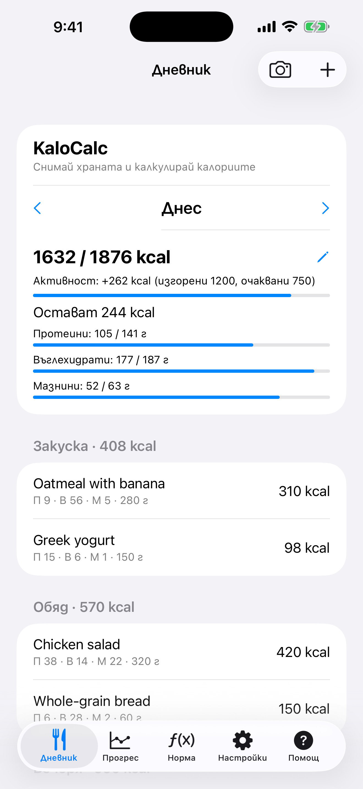
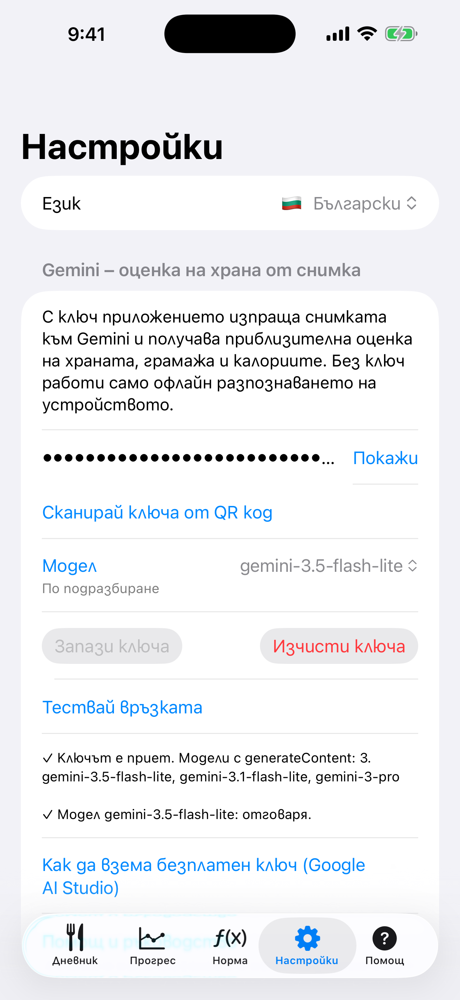

# 1. Първо стартиране и език

Какво виждаш при първото отваряне на KaloCalc и как да смениш езика.

**Предусловия:** Няма. Приложението е безплатно и работи без акаунт. Работи на iPhone с iOS 17 или по-нова версия.

## Стъпки

1. Отвори KaloCalc. Началният екран е разделът **Дневник**: днешният ден, дневната норма (калории и макроси) и четирите хранения. Петте раздела са най-долу: **Дневник**, **Прогрес**, **Норма**, **Настройки** и **Помощ** (отваря това ръководство в браузъра).

   

2. За да смениш езика, отвори **Настройки** и го избери от **Език**: английски, български, немски, френски или испански. Целият интерфейс се сменя веднага и изборът се запомня.

   

## Резултат

При първо стартиране приложението следва езика на iPhone, ако е един от петте, иначе е английски.

---

[Към съдържанието](../../README.bg.md#съдържание) · [Напред →](02-calculator-daily-norm.md)
