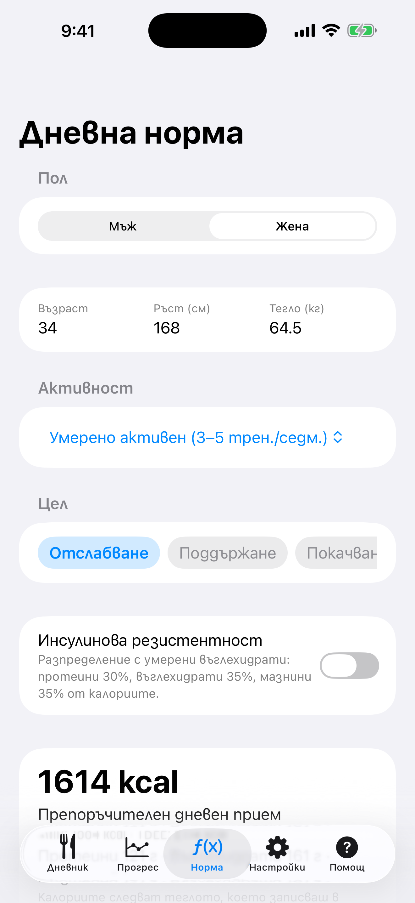
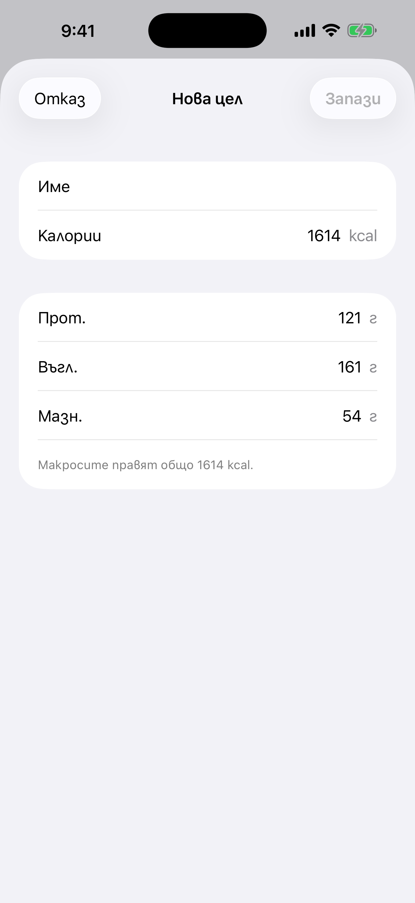
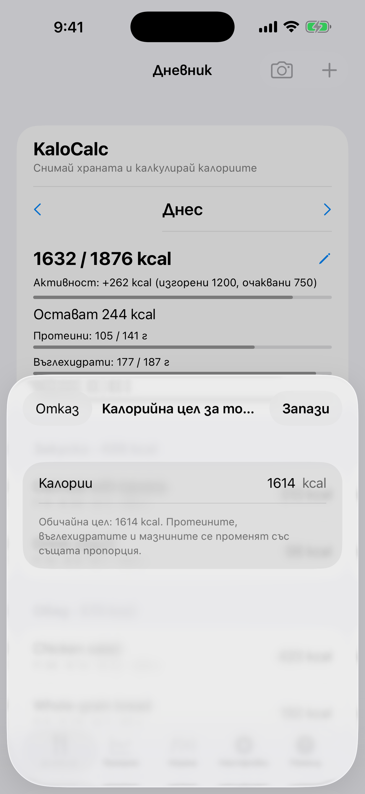

# 2. Дневна норма (калкулатор)

Изчисли препоръчителния дневен прием на калории и макроси.

**Предусловия:** Няма.

## Стъпки

1. Отвори раздела **Норма**. Избери **Пол** и въведи **Възраст**, **Ръст (см)** и **Тегло (кг)**.

   

2. Избери активност и цел (**Отслабване**, **Поддържане** или **Покачване**). Плъзни реда с целите настрани, за да стигнеш до запазените си цели, и добави своя с **Нова цел**. По избор включи **Инсулинова резистентност** за разпределение с умерени въглехидрати.

   

3. Прегледай резултата под **Препоръчителен дневен прием** (BMR, TDEE, протеини, въглехидрати, мазнини) и натисни **Запази профила**.

4. За да смениш целта само за един ден, отвори **Дневник**, натисни молива до калориите за деня и въведи числото. **Върни обичайната цел** връща обичайната цел.

   

## Резултат

Нормата се показва в Дневника и задава графиките в Напредък, а калориите следват теглото, което записваш в **Прогрес**. Формулата е на Mifflin-St Jeor. Това е оценка, не медицински съвет.

---

[← Назад](01-first-start.md) · [Към съдържанието](../../README.bg.md#съдържание) · [Напред →](03-diary-add-manually.md)
