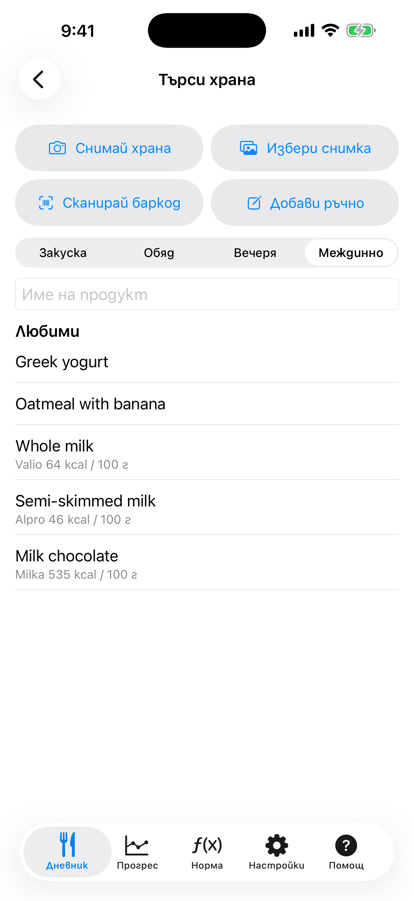
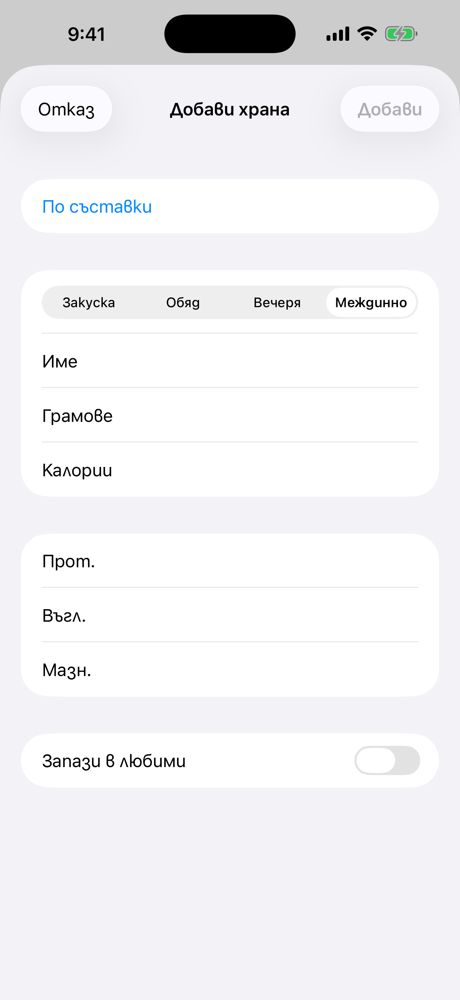
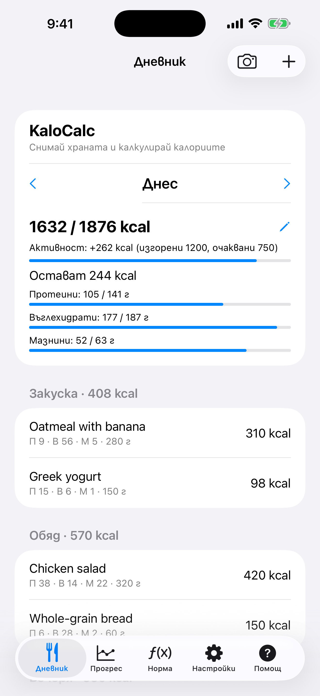

# 3. Ръчно добавяне на храна

Запиши хранене в дневника с име, грамове, калории и макроси.

**Предусловия:** Няма.

## Стъпки

1. В **Дневник** натисни **+** (горе вдясно). На екрана **Търси храна** натисни **Добави ръчно**.

   

2. Избери храненето, въведи **Име**, **Грамове**, **Калории** и протеини, въглехидрати, мазнини, после натисни **Добави**.

   

3. Записът се появява под храненето и сборът и остатъкът за деня се обновяват.

   

## Храна по съставки

За да изчислиш цяло ястие (например закуска с овесени ядки, семена и плод), натисни **Добави ръчно** и после **По съставки**.

1. Въведи име на храната и избери хранене.
2. Натисни **Добави съставка**. Потърси я в Open Food Facts или въведи името и стойностите ръчно.
3. Въведи **Количество**: `50`, `1/2` или `1 1/2`, и избери единица: г, мл, с.л., ч.л., чаша или бр. Грамовете и стойностите се попълват сами. За бройки задай **Грамове на бройка** (например 180 за круша).
4. Повтори за всяка съставка. Общите грамове, калории и макроси най-горе се обновяват след всяка промяна.
5. За да намалиш калориите, промени грамовете на съставка или я махни с кошчето. Когато си доволен, натисни **Добави**. Ако си искал само да изчислиш, натисни **Отказ**.

Отбележи **Запази в любими**, за да запазиш цялата храна със съставките ѝ.

## Резултат

Натисни запис, за да го редактираш. Плъзни го наляво, за да го изтриеш.

---

[← Назад](02-calculator-daily-norm.md) · [Към съдържанието](../../README.bg.md#съдържание) · [Напред →](04-search-and-barcode.md)
