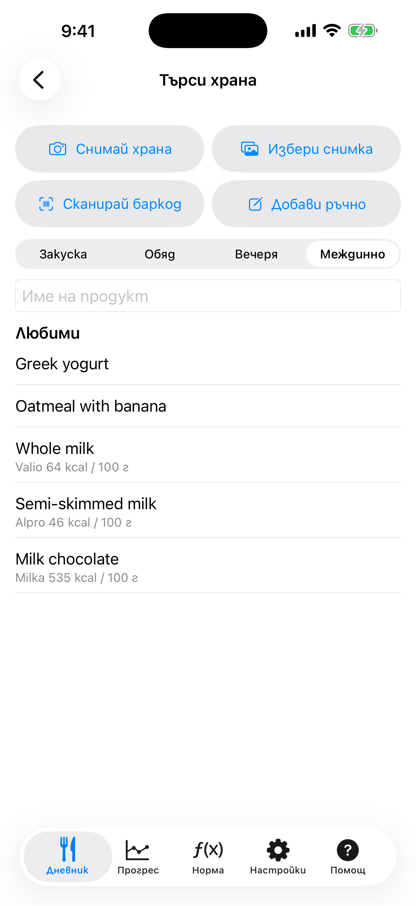

# 4. Търсене на храна и баркод

Намери продукт в Open Food Facts по име или баркод и го добави с порция.

**Предусловия:** Връзка с интернет.

## Стъпки

1. Натисни **+** в **Дневник**. Избери храненето и напиши името в **Име на продукт**, после натисни Търсене на клавиатурата. Любимите са под полето; натисни някоя, за да я добавиш пак.

   

2. Избери продукт от резултатите. Всеки ред показва калориите на 100 г.

3. Въведи грамовете. Калориите и макросите се изчисляват. Натисни **Добави**.

4. За баркод натисни **Сканирай баркод** и насочи камерата към кода на опаковката. Първия път iOS иска разрешение за камерата; ако си отказал, разреши го в приложението Настройки на iPhone, под KaloCalc → Камера.

## Резултат

Ако търсенето намери малко или нищо и имаш Gemini ключ, приложението го превежда на френски, търси пак и връща резултатите на твоя език. Ако баркодът го няма в базата, получаваш съобщение и можеш да добавиш храната ръчно.

---

[← Назад](03-diary-add-manually.md) · [Към съдържанието](../../README.bg.md#съдържание) · [Напред →](05-photo-offline-labels.md)
