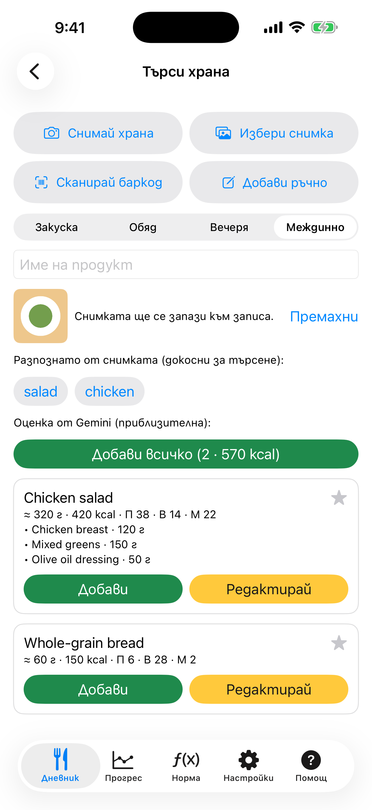

# 5. Снимка на храна: офлайн етикети

Снимай храната и приложението предлага думи за търсене без интернет и без ключ.

**Предусловия:** Камерата или снимка от библиотеката. KaloCalc никога не получава цялата ти библиотека: получава само снимката, която избереш.

## Стъпки

1. Натисни бутона с камера в **Дневник** или **Снимай храна** / **Избери снимка** на екрана **Търси храна**.

2. Разпознаването на устройството (рамката Vision на Apple) предлага общи етикети като „salad“ под „Разпознато от снимката“. Натисни етикет, за да търсиш с него.

   

3. Избери продукт и грамове както при обикновено търсене. Снимката се запазва със записа.

## Резултат

Етикетите са общи, не точно ястие, и на този етап снимката не напуска телефона. За име, грамове и калории виж следващия сценарий.

---

[← Назад](04-search-and-barcode.md) · [Към съдържанието](../../README.bg.md#съдържание) · [Напред →](06-photo-gemini-estimate.md)
