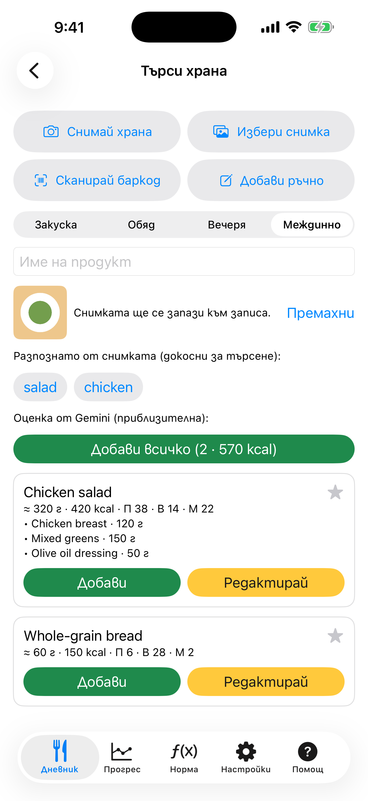

# 6. Снимка на храна: оценка с Gemini

Gemini оценява храненето по снимката: име, грамове, калории и макроси.

**Предусловия:** Gemini API ключ, въведен в Настройки (виж сценарий 10), и твоето съгласие снимките да се изпращат. Докато има ключ, снимката се изпраща към Google при всеки кадър.

## Стъпки

1. Снимай храната или избери снимка. Първия път диалог пита **Да се изпрати ли на Google Gemini?**; прочети го и натисни **Съгласен съм, продължи**. С **Не сега** нищо не се изпраща.

2. След няколко секунди оценката на Gemini се появява под снимката, по една карта за всяка храна със съставките ѝ.

   

3. Натисни зеления **Добави** на картата. Записът отива в избраното хранене като оценка, със снимката. Звездата запазва ястието като любимо.

## Резултат

Оценките са приблизителни. Ако нещо не е вярно, поправи го със следващия сценарий. Без ключ снимката получава само етикетите от устройството.

---

[← Назад](05-photo-offline-labels.md) · [Към съдържанието](../../README.bg.md#съдържание) · [Напред →](07-edit-estimate-add-all.md)
