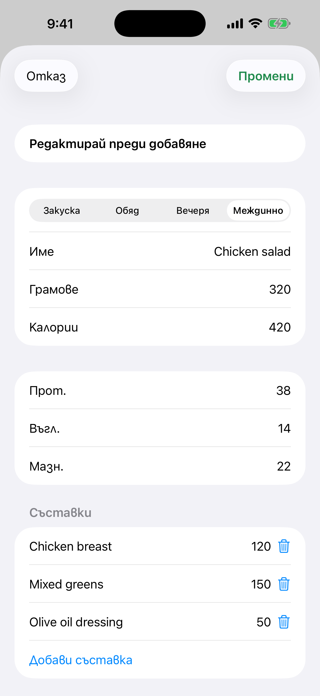

# 7. Поправка на оценка и „Добави всичко“

Коригирай оценка преди да я запазиш и добави всички разпознати храни наведнъж.

**Предусловия:** Оценка от Gemini (сценарий 6).

## Стъпки

1. На картата натисни жълтия бутон **Редактирай**. Промени хранене, име или грамове. Калориите и макросите се преизчисляват спрямо първоначалната оценка.

   

2. Можеш да добавиш или махнеш съставка на ястието.

3. Когато храните са две или повече, натисни зеления бутон най-горе („Добави всичко“, с броя и общите калории), за да ги запазиш в избраното хранене наведнъж.

## Резултат

Всеки запис пази собствено копие на снимката. Добавено ястие изчезва от списъка, а след последното екранът се затваря.

---

[← Назад](06-photo-gemini-estimate.md) · [Към съдържанието](../../README.bg.md#съдържание) · [Напред →](08-progress-charts.md)
