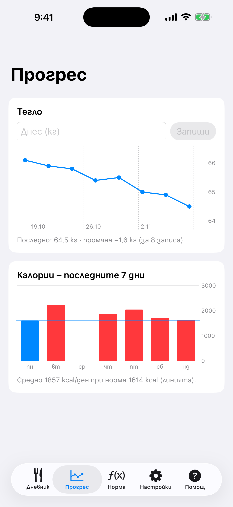

# 8. Напредък: тегло и калории

Записвай теглото си и виж калориите за последните 7 дни.

**Предусловия:** Няма.

## Стъпки

1. Отвори раздела **Прогрес**. Въведи днешното тегло (**Днес (кг)**) и натисни **Запиши**. Линейната графика показва промяната.

   

2. Стълбчетата отдолу са калориите за последните 7 дни, а линията е дневната ти цел.

## Резултат

Целта в раздел Цел следва записаното тегло. Пази се по едно премерване на ден; ново записване в същия ден го замества.

---

[← Назад](07-edit-estimate-add-all.md) · [Към съдържанието](../../README.bg.md#съдържание) · [Напред →](09-apple-health.md)
