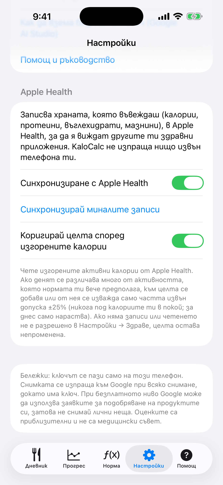
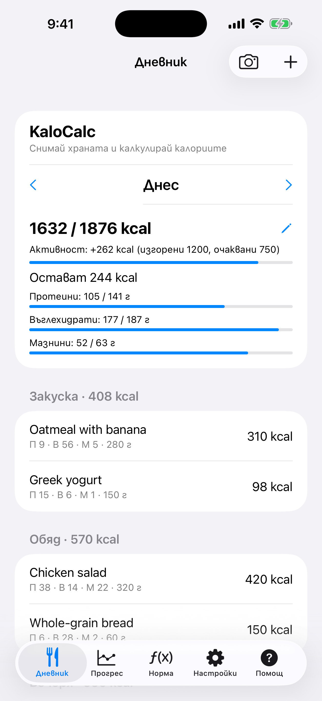

# 9. Apple Health

Записвай въведеното в Apple Health и, ако искаш, остави изгорените калории да коригират целта за деня.

**Предусловия:** iPhone (Health е вграден). И двете опции са изключени, докато не ги включиш.

## Стъпки

1. Отвори **Настройки** и превърти до **Apple Health**.

   

2. Включи **Синхронизиране с Apple Health**. iOS показва прозорец за разрешение; позволи на KaloCalc да записва хранителните данни. Оттук нататък всеки запис, който добавиш или редактираш, се пише в Health (калории, протеини, въглехидрати, мазнини), а изтритият запис се маха. Ако откажеш, превключвателят се връща изключен и съобщение казва къде да го разрешиш: Настройки → Здраве → Достъп до данни и устройства → KaloCalc.

3. Натисни **Синхронизирай миналите записи**, за да запишеш записите отпреди. Безопасно е да се повтаря: всеки запис има постоянен идентификатор, затова замества по-ранното си копие, а не го дублира.

4. За да може активността да мести целта ти, включи **Коригирай целта според изгорените калории** и разреши четенето на Active Energy. Приложението чете само активните калории за деня, който разглеждаш, на телефона.

5. Ако денят се различава много от активността, която нормата ти вече предполага, Дневникът показва ред като „Активност: +262 kcal (изгорени 1200, очаквани 750)“. Брои се само частта извън допуска ±25%. Днес целта само се вдига; приключил ден може и да падне, но никога под калориите ти в покой. Цел, зададена на ръка за деня, не се променя.

   

## Резултат

Нищо не напуска телефона. Записаната храна се вижда в Health под Преглед → Хранене. iOS не казва на приложението дали четенето е отказано, затова без разрешение или без данни целта просто остава непроменена. Можеш да изключиш опция тук или да оттеглиш достъпа по всяко време в Настройки → Здраве → Достъп до данни и устройства → KaloCalc; вече записаните данни остават в Health, докато не ги изтриеш там.

> В iOS приложението още няма файл за резервно копие (експорт/импорт). Данните са на iPhone и влизат в собственото резервно копие на телефона в iCloud или на компютър.

---

[← Назад](08-progress-charts.md) · [Към съдържанието](../../README.bg.md#съдържание) · [Напред →](10-language-and-settings.md)
