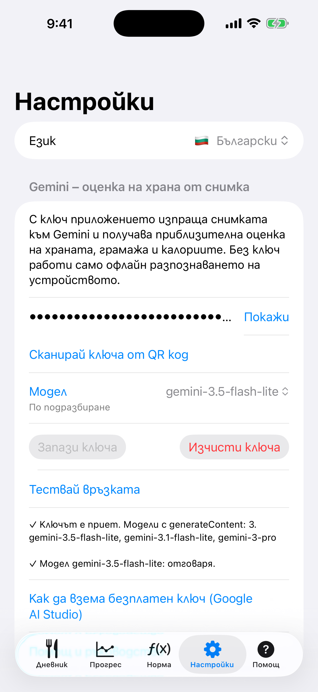
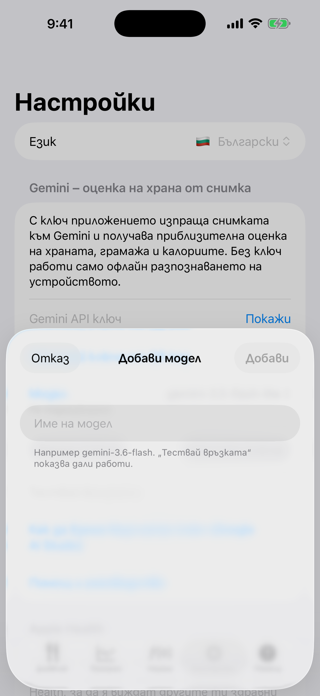

# 10. Настройки: език и Gemini ключ

Избери език, въведи Gemini ключ и избери модел.

**Предусловия:** За ключа: акаунт в Google AI Studio.

## Стъпки

1. Отвори **Настройки**. Постави ключа в **Gemini API ключ** (**Покажи** го разкрива) или ползвай **Сканирай ключа от QR код**, избери **Модел** и натисни **Запази ключа**. Първия път, когато запазиш ключ, диалог те пита дали се съгласяваш снимките да се изпращат към Google. **Тествай връзката** проверява ключа и модела. Как да вземеш ключ е описано по-долу.

   

2. Менюто **Модел** показва стандартните модели, а **Добави свой модел…** ти позволява да напишеш свое име на модел.

   

3. **Изчисти ключа** премахва ключа и съгласието ти. **Помощ и ръководство** отваря това ръководство в браузъра.

## Резултат

Без ключ приложението работи само с офлайн етикетите. Ключът се пази само на телефона, в Keychain на iOS, и резервно копие не го пренася на друго устройство.

## Как да вземеш Gemini ключ

Отвори [aistudio.google.com/api-keys](https://aistudio.google.com/api-keys) в браузър. Подходящ е всеки браузър (Chrome, Firefox, Edge, Safari), на телефона или на компютъра. Ключът е дълъг низ, който започва с `AIza`. Безплатно е, не се иска банкова карта. Ако си влизал и преди в Google AI Studio, ще попаднеш направо в списъка с ключове.

### Не си влязъл в Google акаунт (или не ползваш Chrome)

1. Страницата ще те прати към вход. Въведи имейла и паролата на личния си Google акаунт (Gmail). Ако нямаш такъв, създай го от „Създаване на акаунт“.
2. Ако браузърът не е Chrome, нищо не се променя: влизането е на страницата на Google, не в браузъра.
3. При първо отваряне се появява прозорец с условия за ползване. Отметни и приеми, иначе страницата не продължава.

### Имаш повече от един акаунт

1. Погледни кръглата иконка (снимка или буква) горе вдясно. Пише с кой акаунт си влязъл.
2. Ако не е този, който искаш, натисни иконката и избери друг акаунт или „Добавяне на друг акаунт“.
3. Ако браузърът автоматично те влиза с грешния (например служебен) акаунт, отвори страницата в анонимен/личен прозорец и влез само с желания акаунт.
4. Служебни и училищни акаунти (Google Workspace) често са блокирани от администратора. Ползвай личен акаунт.
5. Ключовете са свързани с акаунта. Ако си създал ключ с един акаунт, няма да го видиш от друг.

### Нямаш ключ: създаване

1. На страницата **API keys** натисни **Create API key** (Създай API ключ).
2. Ще поиска проект на Google Cloud. Ако имаш готов проект, избери го от списъка. Ако нямаш, избери създаване на нов проект. Името няма значение.
3. Ключът се появява в списъка. Копирай го (иконка за копиране до ключа или натисни ключа и после копирай).
4. Ако виждаш съобщение, че няма проекти, първо избери опцията за създаване на проект/импортиране на проект и после повтори стъпка 1.

### Вече имаш ключ: къде да го намериш

1. В същия списък **API keys** са всички ключове на акаунта, с име, проект и дата на създаване.
2. Натисни реда на ключа, за да видиш целия ключ, и го копирай. Ако е показан само частично (`AIza...xxxx`), отвори детайлите му.
3. Не виждаш никакви ключове? Най-вероятно си влязъл с друг акаунт. Смени го (виж по-горе). Ако ключът наистина липсва или не помниш къде е, създай нов; старият не пречи.
4. Не споделяй ключа и не го показвай на снимки. Който го има, ползва твоята квота.

### Как да го сложиш в приложението

- Ако си на телефона: копирай ключа, отвори **Настройки** в приложението, постави го и натисни **Запази ключа**.
- Ако си на компютъра: прати си ключа (например в съобщение до себе си) и го копирай на телефона, или го покажи като QR код и го сканирай от приложението.
- Накрая натисни **Тествай връзката**. Зелен резултат значи, че ключът работи.

---

[← Назад](09-apple-health.md) · [Към съдържанието](../../README.bg.md#съдържание)
