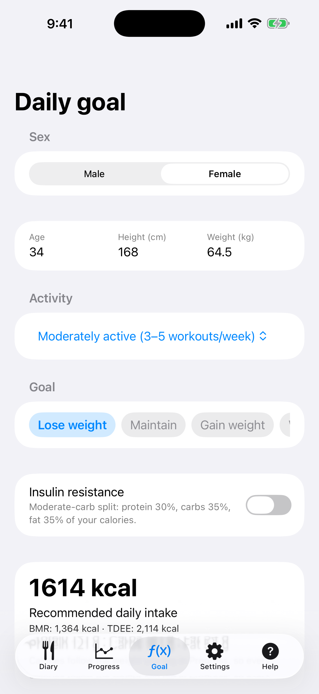
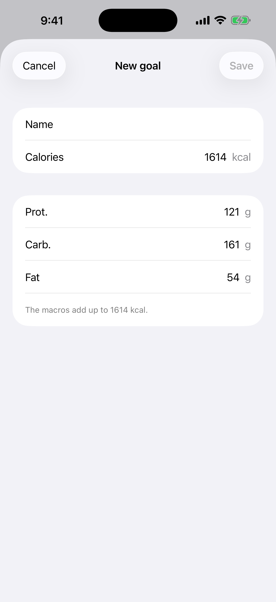
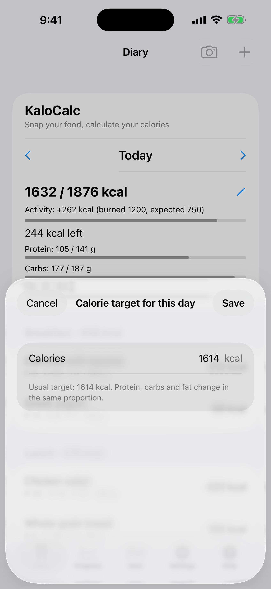

# 2. Tagesziel (Rechner)

Berechne die empfohlene Tageszufuhr an Kalorien und Makros.

**Voraussetzungen:** Keine.

## Schritte

1. Öffne den Tab **Ziel**. Wähle **Geschlecht** und gib **Alter**, **Größe (cm)** und **Gewicht (kg)** ein.

   

2. Wähle Aktivität und Ziel (**Abnehmen**, **Gewicht halten** oder **Zunehmen**). Streiche die Zielzeile seitwärts, um zu deinen gespeicherten Zielen zu kommen, und lege mit **Neues Ziel** ein eigenes an. Optional schaltest du **Insulinresistenz** für eine Aufteilung mit moderaten Kohlenhydraten ein.

   

3. Prüfe das Ergebnis unter **Empfohlene Tageszufuhr** (BMR, TDEE, Eiweiß, Kohlenhydrate, Fett) und tippe auf **Profil speichern**.

4. Um das Ziel nur für einen Tag zu ändern, öffne das **Tagebuch**, tippe auf den Stift neben den Kalorien des Tages und gib die Zahl ein. **Zurück zum üblichen Ziel** stellt das übliche Ziel wieder her.

   

## Ergebnis

Das Ziel erscheint im Tagebuch und bestimmt die Diagramme unter Verlauf, und die Kalorien folgen dem Gewicht, das du unter **Verlauf** einträgst. Die Formel ist Mifflin-St Jeor. Das ist eine Schätzung, keine medizinische Beratung.

---

[← Zurück](01-first-start.md) · [Zum Inhalt](../../README.de.md#inhalt) · [Weiter →](03-diary-add-manually.md)
