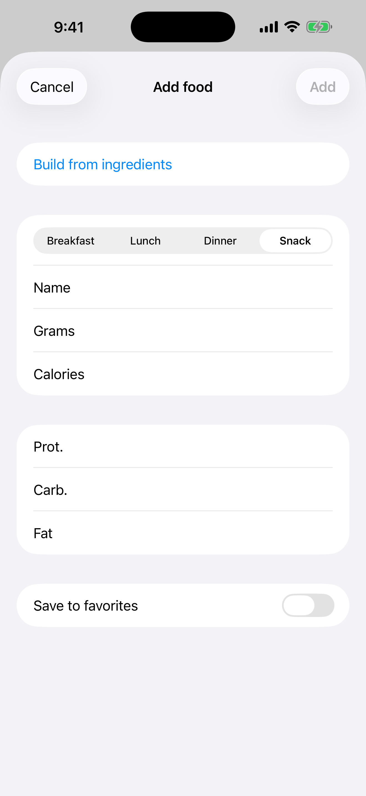

# 3. Essen manuell hinzufügen

Trage eine Mahlzeit mit Name, Gramm, Kalorien und Makros ins Tagebuch ein.

**Voraussetzungen:** Keine.

## Schritte

1. Tippe im **Tagebuch** auf **+** (oben rechts). Tippe auf dem Bildschirm **Essen suchen** auf **Manuell hinzufügen**.

   

2. Wähle die Mahlzeit, gib **Name**, **Gramm**, **Kalorien** sowie Eiweiß, Kohlenhydrate und Fett ein und tippe auf **Hinzufügen**.

   

3. Der Eintrag erscheint unter seiner Mahlzeit, und Tagessumme und Rest werden aktualisiert.

   

## Mahlzeit aus Zutaten erstellen

Um ein ganzes Gericht zu berechnen (zum Beispiel ein Frühstück aus Haferflocken, Samen und Obst), tippe auf **Manuell hinzufügen** und dann auf **Aus Zutaten erstellen**.

1. Gib einen Namen für die Mahlzeit ein und wähle die Mahlzeit.
2. Tippe auf **Zutat hinzufügen**. Suche sie in Open Food Facts oder gib Name und Nährwerte selbst ein.
3. Gib die **Menge** ein: `50`, `1/2` oder `1 1/2`, und wähle die Einheit: g, ml, EL, TL, Tasse oder Stk. Gramm und Nährwerte werden für dich ausgefüllt. Bei Stückzahlen stelle **Gramm pro Stück** ein (zum Beispiel 180 für eine Birne).
4. Wiederhole das für jede Zutat. Gesamtgramm, Kalorien und Makros oben werden nach jeder Änderung aktualisiert.
5. Um die Kalorien zu senken, ändere die Gramm einer Zutat oder entferne sie mit dem Papierkorb. Wenn du zufrieden bist, tippe auf **Hinzufügen**. Tippe auf **Abbrechen**, wenn du nur rechnen wolltest.

Hake **Zu Favoriten hinzufügen** an, um die ganze Mahlzeit mit ihren Zutaten zu behalten.

## Ergebnis

Tippe auf einen Eintrag, um ihn zu bearbeiten. Wische ihn nach links, um ihn zu löschen.

---

[← Zurück](02-calculator-daily-norm.md) · [Zum Inhalt](../../README.de.md#inhalt) · [Weiter →](04-search-and-barcode.md)
