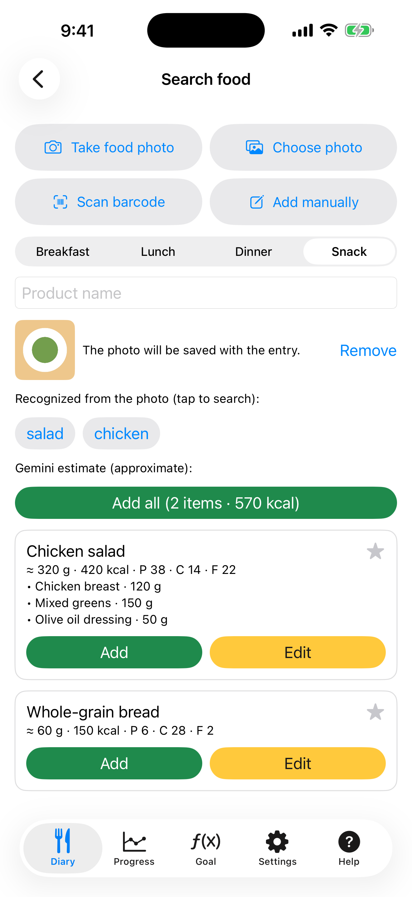

# 5. Essensfoto: Offline-Labels

Fotografiere die Mahlzeit und die App schlägt Suchbegriffe vor, ohne Internet und ohne Schlüssel.

**Voraussetzungen:** Die Kamera oder ein Foto in deiner Mediathek. KaloCalc bekommt nie deine ganze Mediathek, sondern nur das Foto, das du auswählst.

## Schritte

1. Tippe im **Tagebuch** auf die Kamera-Taste oder auf dem Bildschirm **Essen suchen** auf **Essen fotografieren** / **Foto auswählen**.

2. Die Erkennung auf dem Gerät (Apples Vision-Framework) schlägt allgemeine Labels wie „salad“ unter „Aus dem Foto erkannt“ vor. Tippe auf ein Label, um damit zu suchen.

   

3. Wähle Produkt und Gramm wie bei einer normalen Suche. Das Foto wird mit dem Eintrag gespeichert.

## Ergebnis

Die Labels sind allgemein, kein exaktes Gericht, und in diesem Schritt verlässt das Foto das Telefon nicht. Für Name, Gramm und Kalorien siehe das nächste Szenario.

---

[← Zurück](04-search-and-barcode.md) · [Zum Inhalt](../../README.de.md#inhalt) · [Weiter →](06-photo-gemini-estimate.md)
