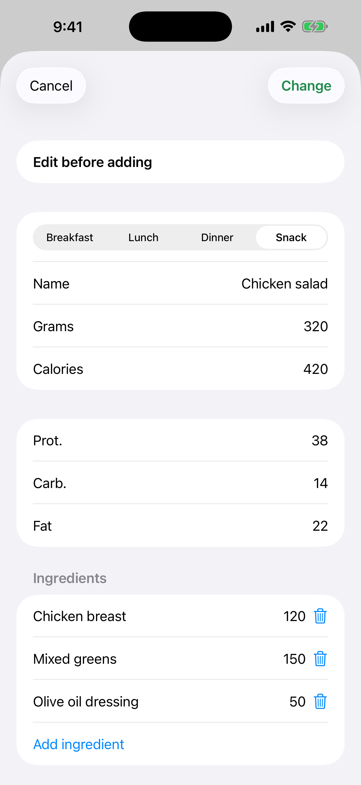

# 7. Schätzung korrigieren und „Alle hinzufügen“

Korrigiere eine Schätzung vor dem Speichern und füge alle erkannten Speisen auf einmal hinzu.

**Voraussetzungen:** Eine Gemini-Schätzung (Szenario 6).

## Schritte

1. Tippe auf der Karte auf die gelbe Taste **Bearbeiten**. Ändere Mahlzeit, Name oder Gramm. Kalorien und Makros werden anhand der ursprünglichen Schätzung neu skaliert.

   

2. Du kannst eine Zutat des Gerichts hinzufügen oder entfernen.

3. Sind es zwei oder mehr Speisen, tippe oben auf die grüne Taste („Alle hinzufügen“ mit Anzahl und Gesamtkalorien), um sie auf einmal in der gewählten Mahlzeit zu speichern.

## Ergebnis

Jeder Eintrag behält eine eigene Kopie des Fotos. Ein hinzugefügtes Gericht verschwindet aus der Liste, und nach dem letzten schließt sich der Bildschirm.

---

[← Zurück](06-photo-gemini-estimate.md) · [Zum Inhalt](../../README.de.md#inhalt) · [Weiter →](08-progress-charts.md)
