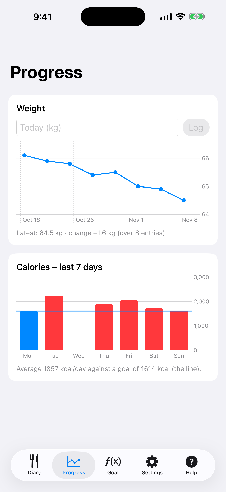

# 8. Verlauf: Gewicht und Kalorien

Trage dein Gewicht ein und sieh die Kalorien der letzten 7 Tage.

**Voraussetzungen:** Keine.

## Schritte

1. Öffne den Tab **Verlauf**. Gib das heutige Gewicht (**Heute (kg)**) ein und tippe auf **Eintragen**. Das Liniendiagramm zeigt die Veränderung.

   

2. Die Balken darunter sind die Kalorien der letzten 7 Tage, die Linie ist dein Tagesziel.

## Ergebnis

Das Ziel im Tab Ziel folgt dem eingetragenen Gewicht. Pro Tag wird eine Wiegung gespeichert; ein erneuter Eintrag am selben Tag ersetzt sie.

---

[← Zurück](07-edit-estimate-add-all.md) · [Zum Inhalt](../../README.de.md#inhalt) · [Weiter →](09-apple-health.md)
