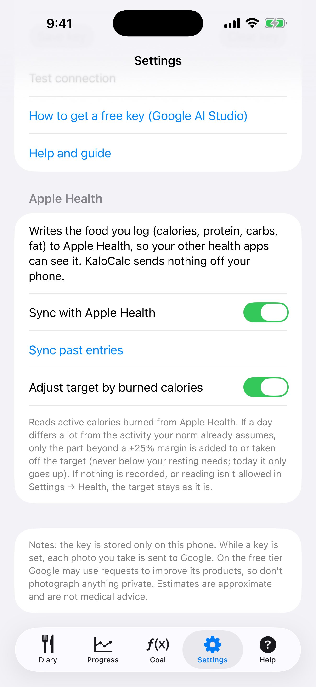

# 9. Apple Health

Schreibe, was du einträgst, in Apple Health und lass auf Wunsch die verbrannten Kalorien das Tagesziel anpassen.

**Voraussetzungen:** Ein iPhone (Health ist eingebaut). Beide Optionen sind aus, bis du sie einschaltest.

## Schritte

1. Öffne **Einstellungen** und scrolle zu **Apple Health**.

   

2. Schalte **Mit Apple Health synchronisieren** ein. iOS zeigt ein Berechtigungsfenster; erlaube KaloCalc, die Ernährungsdaten zu schreiben. Danach wird jeder Eintrag, den du hinzufügst oder änderst, in Health geschrieben (Kalorien, Eiweiß, Kohlenhydrate, Fett), und ein gelöschter Eintrag wird entfernt. Lehnst du ab, springt der Schalter zurück auf aus und eine Meldung sagt, wo du es erlaubst: Einstellungen → Health → Datenzugriff & Geräte → KaloCalc.

3. Tippe auf **Frühere Einträge synchronisieren**, um frühere Einträge zu schreiben. Das ist beliebig wiederholbar: Jeder Eintrag hat eine feste ID und ersetzt seine frühere Kopie, statt sie zu verdoppeln.

4. Damit Aktivität dein Ziel verschiebt, schalte **Ziel nach verbrannten Kalorien anpassen** ein und erlaube das Lesen von Aktive Energie. Die App liest nur die aktiven Kalorien des angezeigten Tages, auf dem Telefon.

5. Weicht ein Tag stark von der Aktivität ab, die dein Normwert schon annimmt, zeigt das Tagebuch eine Zeile wie „Aktivität: +262 kcal (verbrannt 1200, erwartet 750)“. Nur der Teil jenseits eines Spielraums von ±25 % zählt. Heute steigt das Ziel nur; ein abgeschlossener Tag kann auch sinken, aber nie unter deinen Grundbedarf. Ein von Hand gesetztes Tagesziel wird nicht verändert.

   

## Ergebnis

Nichts verlässt das Telefon. Geschriebenes Essen erscheint in Health unter Durchsuchen → Ernährung. iOS sagt einer App nicht, ob das Lesen abgelehnt wurde; ohne Berechtigung oder ohne Daten bleibt das Ziel einfach unverändert. Du kannst eine Option hier ausschalten oder den Zugriff jederzeit unter Einstellungen → Health → Datenzugriff & Geräte → KaloCalc widerrufen; bereits geschriebene Einträge bleiben in Health, bis du sie dort löschst.

> Die iOS-App hat noch keine Sicherungsdatei (Export/Import). Deine Daten liegen auf dem iPhone und sind in der eigenen iCloud- oder Computer-Sicherung des iPhones enthalten.

---

[← Zurück](08-progress-charts.md) · [Zum Inhalt](../../README.de.md#inhalt) · [Weiter →](10-language-and-settings.md)
