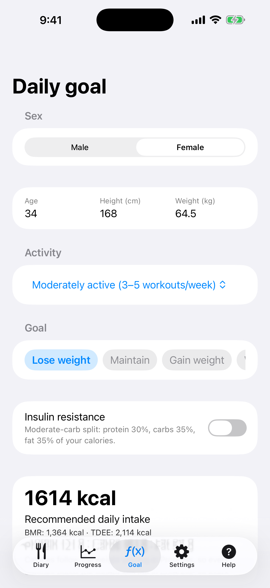
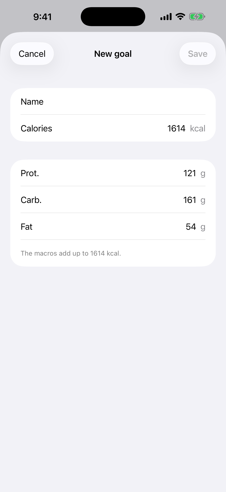
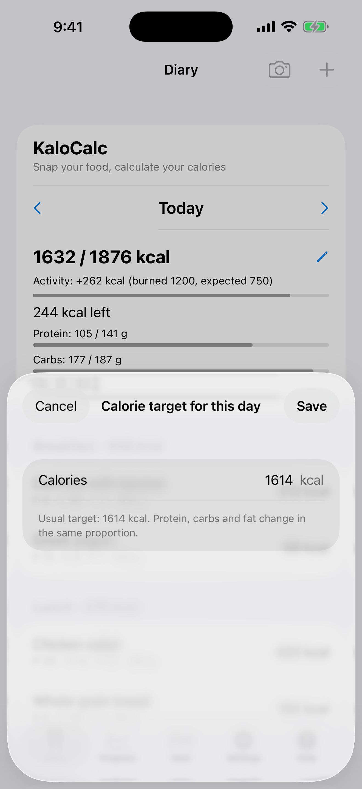

# 2. Daily goal (calculator)

Work out the recommended daily intake of calories and macros.

**Prerequisites:** None.

## Steps

1. Open the **Goal** tab. Pick **Sex** and enter **Age**, **Height (cm)** and **Weight (kg)**.

   

2. Choose the activity level and the goal (**Lose weight**, **Maintain** or **Gain weight**). Scroll the goal row sideways to reach your saved goals, and add your own with **New goal**. Optionally turn on **Insulin resistance** for a moderate-carb split.

   

3. Check the result under **Recommended daily intake** (BMR, TDEE, protein, carbs, fat) and tap **Save profile**.

4. To change the target for one day only, open the **Diary**, tap the pencil next to the day's calories and enter the number. **Back to the usual target** returns to the usual target.

   

## Result

The goal shows in the Diary and drives the Progress charts, and the calories follow the weight you log in **Progress**. The formula is Mifflin-St Jeor. It is an estimate, not medical advice.

---

[← Previous](01-first-start.md) · [Back to contents](../../README.md#contents) · [Next →](03-diary-add-manually.md)
