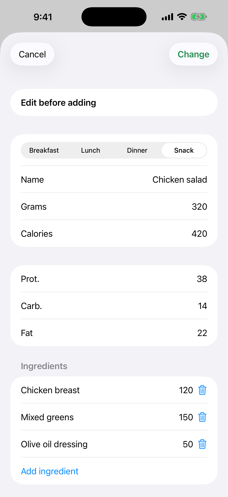

# 7. Fix an estimate and “Add all”

Correct an estimate before saving it and add every recognised food at once.

**Prerequisites:** A Gemini estimate (scenario 6).

## Steps

1. On a card tap the yellow **Edit** button. Change meal, name or grams. Calories and macros are rescaled from the original estimate.

   

2. You can add or remove an ingredient of the dish.

3. When there are two or more foods, tap the green button at the top (“Add all”, with the number of items and the total calories) to save them in the selected meal at once.

## Result

Every entry keeps its own copy of the photo. A dish you add leaves the list, and after the last one the screen closes.

---

[← Previous](06-photo-gemini-estimate.md) · [Back to contents](../../README.md#contents) · [Next →](08-progress-charts.md)
