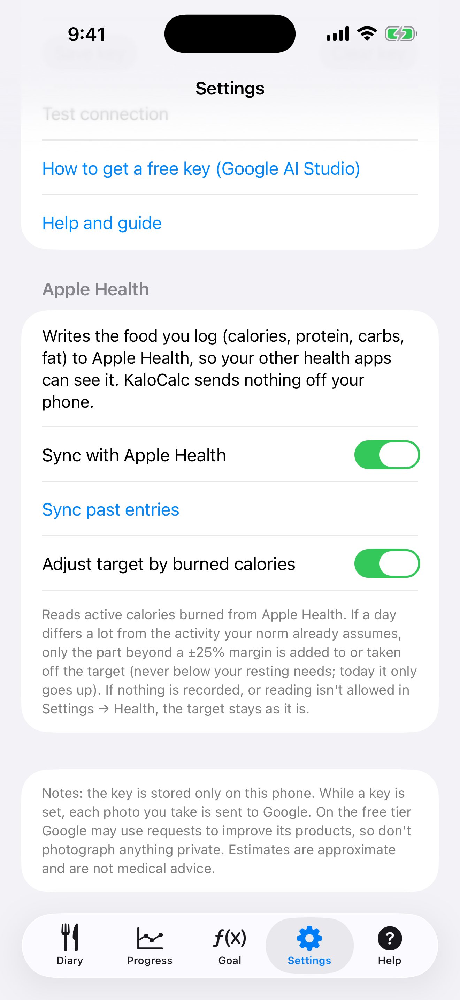

# 9. Apple Health

Write what you log to Apple Health and, if you like, let the calories you burn adjust the day's target.

**Prerequisites:** An iPhone (Health is built in). Both options are off until you turn them on.

## Steps

1. Open **Settings** and scroll to **Apple Health**.

   

2. Turn on **Sync with Apple Health**. iOS shows a permission sheet; allow KaloCalc to write the nutrition items. From then on every entry you add or edit is written to Health (calories, protein, carbs, fat) and a deleted entry is removed. If you refuse, the switch goes back off and a message says where to allow it: Settings → Health → Data Access & Devices → KaloCalc.

3. Tap **Sync past entries** to write the entries you made before. It is safe to repeat: each entry has a fixed id, so it replaces its earlier copy instead of duplicating it.

4. To let activity move your target, turn on **Adjust target by burned calories** and allow reading Active Energy. The app reads only the active calories of the day you are viewing, on the phone.

5. If a day differs a lot from the activity your norm already assumes, the Diary shows a line such as “Activity: +262 kcal (burned 1200, expected 750)”. Only the part beyond a ±25% margin counts. Today the target only goes up; a finished day can also go down, but never below your resting needs. A target you set by hand for a day is not changed.

   

## Result

Nothing leaves the phone. Food you write shows in Health under Browse → Nutrition. iOS does not tell an app whether reading was refused, so without permission or without data the target simply stays as it is. You can switch an option off here or revoke access any time in Settings → Health → Data Access & Devices → KaloCalc; entries already written stay in Health until you delete them there.

> The iOS app has no backup file (export/import) yet. Your data lives on the iPhone and is included in the iPhone's own iCloud or computer backup.

---

[← Previous](08-progress-charts.md) · [Back to contents](../../README.md#contents) · [Next →](10-language-and-settings.md)
