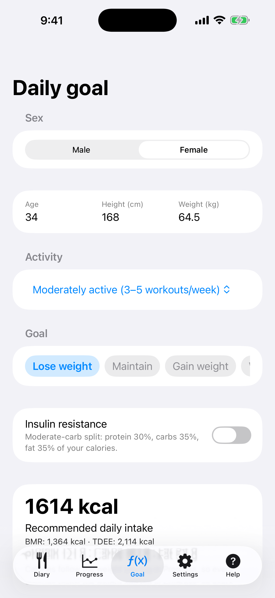
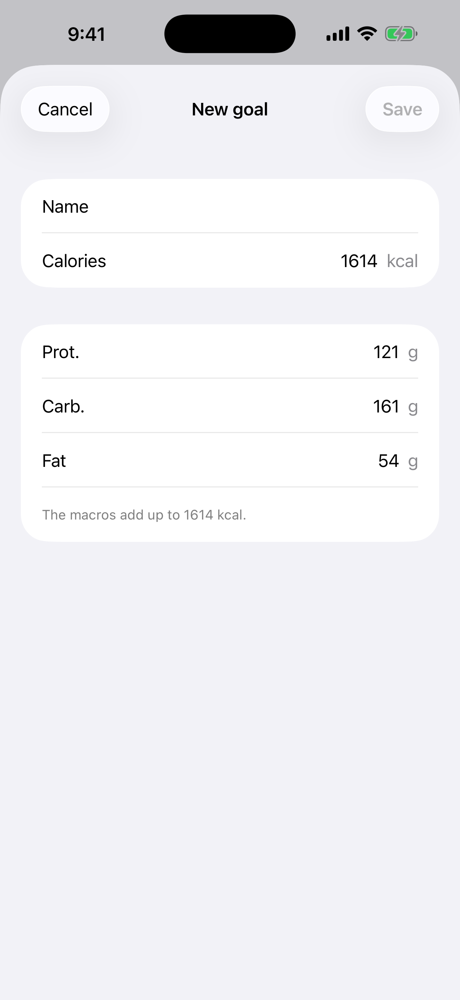
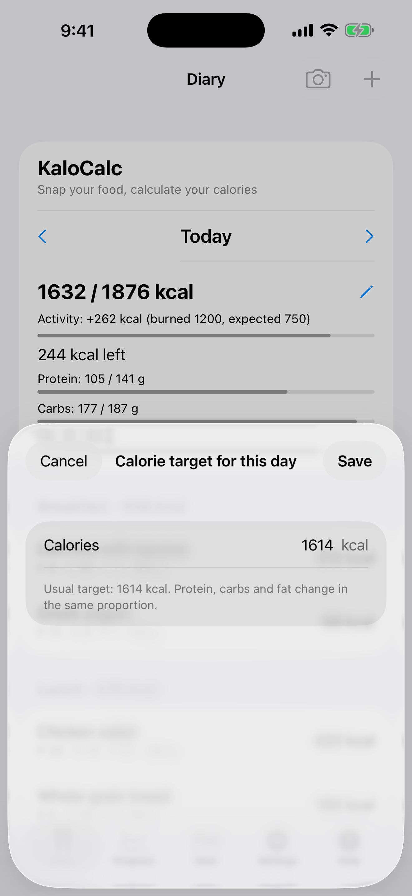

# 2. Objetivo diario (calculadora)

Calcula la ingesta diaria recomendada de calorías y macros.

**Requisitos:** Ninguno.

## Pasos

1. Abre la pestaña **Objetivo**. Elige **Sexo** e introduce **Edad**, **Altura (cm)** y **Peso (kg)**.

   

2. Elige la actividad y el objetivo (**Perder peso**, **Mantener** o **Ganar peso**). Desliza la fila de objetivos hacia un lado para llegar a tus objetivos guardados y crea el tuyo con **Nuevo objetivo**. Opcionalmente activa **Resistencia a la insulina** para un reparto con carbohidratos moderados.

   

3. Revisa el resultado en **Ingesta diaria recomendada** (BMR, TDEE, proteínas, carbohidratos, grasas) y toca **Guardar perfil**.

4. Para cambiar el objetivo de un solo día, abre el **Diario**, toca el lápiz junto a las calorías del día e introduce el número. **Volver al objetivo habitual** vuelve al objetivo habitual.

   

## Resultado

El objetivo aparece en el Diario y marca los gráficos de Progreso, y las calorías siguen el peso que registras en **Progreso**. La fórmula es Mifflin-St Jeor. Es una estimación, no un consejo médico.

---

[← Anterior](01-first-start.md) · [Volver al contenido](../../README.es.md#contenido) · [Siguiente →](03-diary-add-manually.md)
