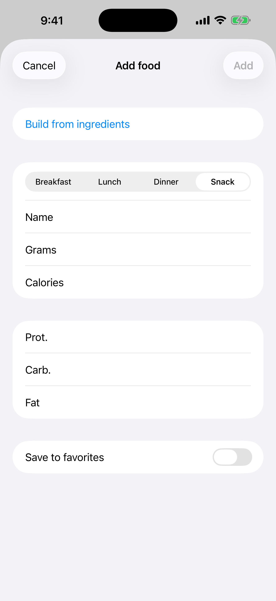

# 3. Añadir comida manualmente

Registra una comida en el diario con nombre, gramos, calorías y macros.

**Requisitos:** Ninguno.

## Pasos

1. En el **Diario** toca **+** (arriba a la derecha). En la pantalla **Buscar comida** toca **Añadir manualmente**.

   

2. Elige la comida, introduce **Nombre**, **Gramos**, **Calorías** y proteínas, carbohidratos y grasas, y toca **Añadir**.

   

3. La entrada aparece bajo su comida y el total y lo que queda del día se actualizan.

   

## Crear una comida por ingredientes

Para calcular un plato entero (por ejemplo, un desayuno de avena, semillas y fruta), toca **Añadir manualmente** y luego **Crear por ingredientes**.

1. Escribe un nombre para la comida y elige la comida del día.
2. Toca **Añadir ingrediente**. Búscalo en Open Food Facts o escribe tú mismo el nombre y los valores nutricionales.
3. Introduce la **Cantidad**: `50`, `1/2` o `1 1/2`, y elige la unidad: g, ml, cda., cdta., taza o ud. Los gramos y los valores se rellenan solos. Para unidades, ajusta los **Gramos por unidad** (por ejemplo 180 para una pera).
4. Repite con cada ingrediente. El total de gramos, calorías y macros de arriba se actualiza tras cada cambio.
5. Para bajar las calorías, cambia los gramos de un ingrediente o quítalo con la papelera. Cuando estés conforme, toca **Añadir**. Toca **Cancelar** si solo querías calcular.

Marca **Añadir a favoritos** para guardar toda la comida con sus ingredientes.

## Resultado

Toca una entrada para editarla. Desliza hacia la izquierda para borrarla.

---

[← Anterior](02-calculator-daily-norm.md) · [Volver al contenido](../../README.es.md#contenido) · [Siguiente →](04-search-and-barcode.md)
