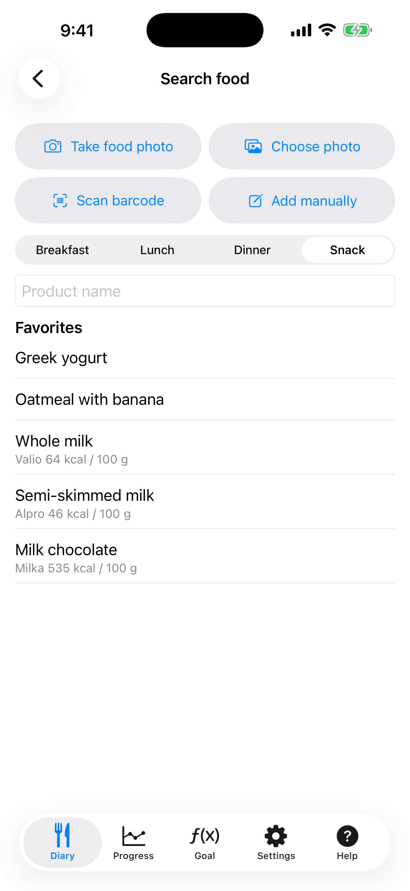

# 4. Buscar comida y código de barras

Encuentra un producto en Open Food Facts por nombre o código de barras y añádelo con una ración.

**Requisitos:** Conexión a internet.

## Pasos

1. Toca **+** en el **Diario**. Elige la comida y escribe el nombre en **Nombre del producto**, luego toca Buscar en el teclado. Tus favoritos aparecen bajo el campo; toca uno para añadirlo otra vez.

   

2. Elige un producto de los resultados. Cada fila muestra las calorías por 100 g.

3. Introduce los gramos. Las calorías y los macros se calculan. Toca **Añadir**.

4. Para un código de barras toca **Escanear código de barras** y apunta la cámara al código del envase. La primera vez iOS pide permiso para la cámara; si lo rechazaste, permítelo en la app Ajustes del iPhone, en KaloCalc → Cámara.

## Resultado

Si una búsqueda encuentra poco o nada y tienes una clave de Gemini, la aplicación la traduce al francés, busca de nuevo y devuelve los resultados en tu idioma. Si un código de barras no está en la base, recibes un mensaje y puedes añadir la comida manualmente.

---

[← Anterior](03-diary-add-manually.md) · [Volver al contenido](../../README.es.md#contenido) · [Siguiente →](05-photo-offline-labels.md)
