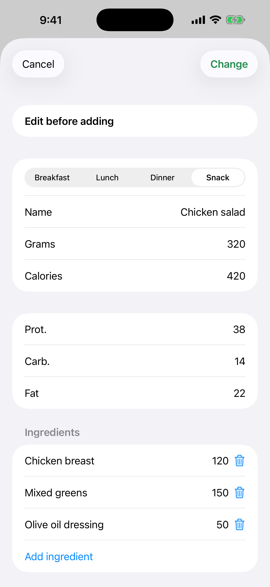

# 7. Corregir una estimación y «Añadir todo»

Corrige una estimación antes de guardarla y añade todas las comidas reconocidas de una vez.

**Requisitos:** Una estimación de Gemini (escenario 6).

## Pasos

1. En una tarjeta toca el botón amarillo **Editar**. Cambia la comida, el nombre o los gramos. Las calorías y los macros se reescalan a partir de la estimación original.

   

2. Puedes añadir o quitar un ingrediente del plato.

3. Cuando hay dos o más comidas, toca el botón verde de arriba («Añadir todo», con el número y el total de calorías) para guardarlas de una vez en la comida elegida.

## Resultado

Cada entrada conserva su propia copia de la foto. Un plato añadido sale de la lista y, tras el último, la pantalla se cierra.

---

[← Anterior](06-photo-gemini-estimate.md) · [Volver al contenido](../../README.es.md#contenido) · [Siguiente →](08-progress-charts.md)
