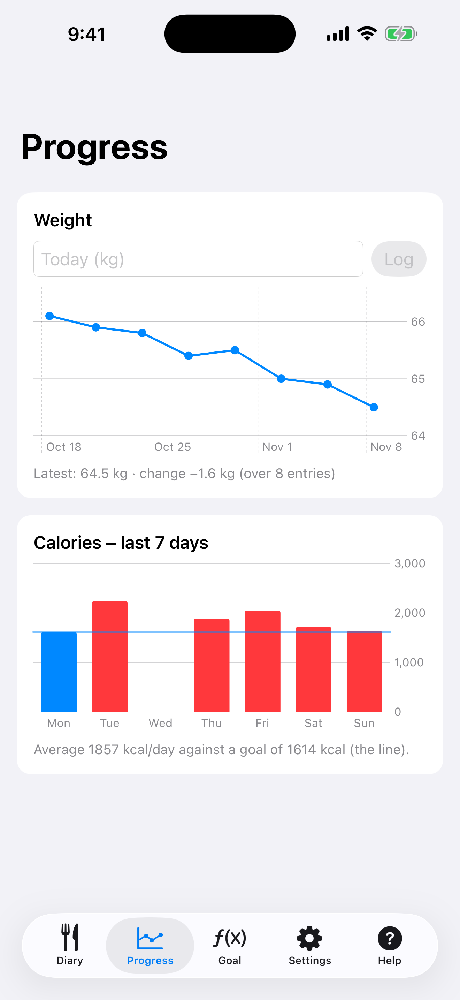

# 8. Progreso: peso y calorías

Registra tu peso y revisa las calorías de los últimos 7 días.

**Requisitos:** Ninguno.

## Pasos

1. Abre la pestaña **Progreso**. Introduce el peso de hoy (**Hoy (kg)**) y toca **Registrar**. El gráfico de líneas muestra el cambio.

   

2. Las barras de abajo son las calorías de los últimos 7 días y la línea es tu objetivo diario.

## Resultado

El objetivo de la pestaña Objetivo sigue el peso registrado. Se guarda un pesaje por día; registrar otro el mismo día lo sustituye.

---

[← Anterior](07-edit-estimate-add-all.md) · [Volver al contenido](../../README.es.md#contenido) · [Siguiente →](09-apple-health.md)
