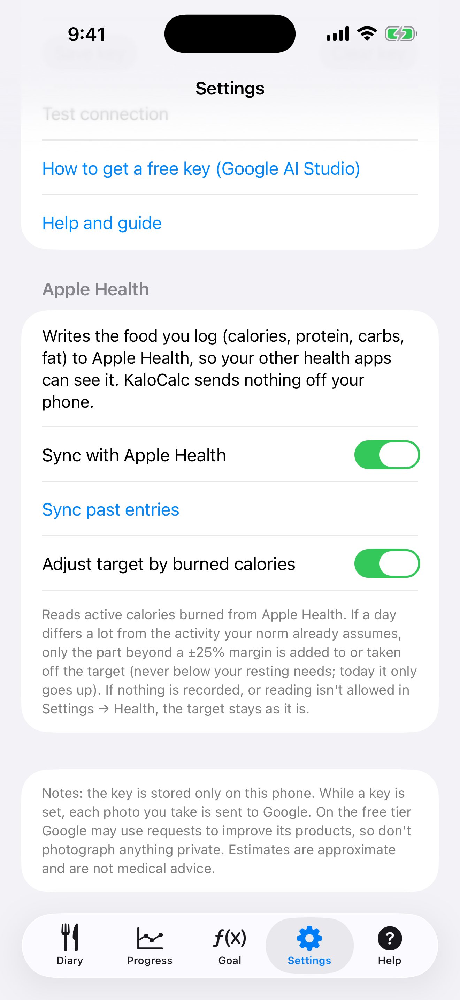

# 9. Apple Salud

Escribe lo que registras en Apple Salud y, si quieres, deja que las calorías quemadas ajusten el objetivo del día.

**Requisitos:** Un iPhone (Salud viene integrado). Las dos opciones están desactivadas hasta que las actives.

## Pasos

1. Abre **Ajustes** y desplázate hasta **Apple Health**.

   

2. Activa **Sincronizar con Apple Salud**. iOS muestra una ventana de permiso; permite que KaloCalc escriba los datos de nutrición. Desde entonces cada entrada que añades o editas se escribe en Salud (calorías, proteínas, carbohidratos, grasas) y una entrada borrada se elimina. Si lo rechazas, el interruptor vuelve a desactivarse y un mensaje indica dónde permitirlo: Ajustes → Salud → Acceso a datos y dispositivos → KaloCalc.

3. Toca **Sincronizar registros anteriores** para escribir las entradas anteriores. Se puede repetir sin riesgo: cada entrada tiene un id fijo y sustituye su copia anterior en lugar de duplicarla.

4. Para que la actividad mueva tu objetivo, activa **Ajustar el objetivo según las calorías quemadas** y permite leer la energía activa. La aplicación lee solo las calorías activas del día que estás viendo, en el teléfono.

5. Si un día se aparta mucho de la actividad que tu norma ya supone, el Diario muestra una línea como «Actividad: +262 kcal (quemadas 1200, esperadas 750)». Solo cuenta la parte que supera un margen de ±25 %. Hoy el objetivo solo sube; un día terminado también puede bajar, pero nunca por debajo de tus necesidades en reposo. Un objetivo fijado a mano para un día no se modifica.

   

## Resultado

Nada sale del teléfono. La comida escrita aparece en Salud en Explorar → Nutrición. iOS no dice a una app si la lectura fue rechazada: sin permiso o sin datos, el objetivo simplemente queda como está. Puedes desactivar una opción aquí o revocar el acceso en cualquier momento en Ajustes → Salud → Acceso a datos y dispositivos → KaloCalc; las entradas ya escritas permanecen en Salud hasta que las borres allí.

> La app de iOS aún no tiene archivo de copia de seguridad (exportar/importar). Tus datos están en el iPhone y forman parte de la copia de seguridad del propio iPhone en iCloud o en el ordenador.

---

[← Anterior](08-progress-charts.md) · [Volver al contenido](../../README.es.md#contenido) · [Siguiente →](10-language-and-settings.md)
