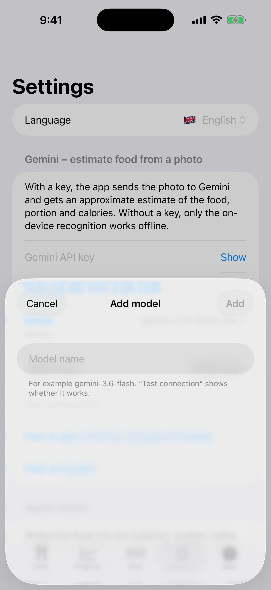

# 10. Ajustes: idioma y clave de Gemini

Elige el idioma, introduce una clave de Gemini y elige un modelo.

**Requisitos:** Para la clave: una cuenta de Google AI Studio.

## Pasos

1. Abre **Ajustes**. Pega la clave en **Clave de API de Gemini** (**Mostrar** la muestra) o usa **Escanear la clave desde un código QR**, elige un **Modelo** y toca **Guardar clave**. La primera vez que guardas una clave, una alerta pregunta si aceptas enviar fotos a Google. **Probar conexión** comprueba la clave y el modelo. Cómo conseguir una clave se describe más abajo.

   

2. El menú **Modelo** lista los modelos predeterminados, y **Añadir tu propio modelo…** permite escribir el nombre de tu propio modelo.

   

3. **Borrar clave** elimina la clave y tu acuerdo. **Ayuda y guía** abre esta guía en el navegador.

## Resultado

Sin clave, la aplicación solo funciona con las etiquetas sin conexión. La clave se guarda solo en el teléfono, en el llavero de iOS, y una copia de seguridad no la traslada a otro dispositivo.

## Cómo conseguir una clave de Gemini

Abre [aistudio.google.com/api-keys](https://aistudio.google.com/api-keys) en un navegador. Sirve cualquier navegador (Chrome, Firefox, Edge, Safari), en el teléfono o en un ordenador. La clave es una cadena larga que empieza por `AIza`. Es gratuita y no pide tarjeta bancaria. Si ya has usado Google AI Studio, llegas directamente a la lista de claves.

### No has iniciado sesión en Google (o no usas Chrome)

1. La página te lleva a iniciar sesión. Introduce el correo y la contraseña de tu cuenta personal de Google (Gmail). Si no tienes, crea una con «Crear cuenta».
2. Si el navegador no es Chrome, no cambia nada: inicias sesión en la página de Google, no en el navegador.
3. En la primera visita aparece un cuadro con las condiciones de uso. Márcalo y acéptalo; si no, la página no continúa.

### Tienes más de una cuenta

1. Mira el icono redondo (foto o letra) arriba a la derecha. Indica con qué cuenta has iniciado sesión.
2. Si no es la que quieres, toca el icono y elige otra cuenta o «Añadir otra cuenta».
3. Si el navegador te mete siempre con la cuenta equivocada (por ejemplo, la del trabajo), abre la página en una ventana de incógnito/privada e inicia sesión solo con la cuenta que quieres.
4. Las cuentas de trabajo y de centros educativos (Google Workspace) suelen estar bloqueadas por el administrador. Usa una cuenta personal.
5. Las claves pertenecen a una cuenta. Una clave creada con una cuenta no se ve desde otra.

### No tienes clave: créala

1. En la página **API keys** toca **Create API key**.
2. Te pedirá un proyecto de Google Cloud. Si ya tienes uno, elígelo de la lista. Si no, elige crear un proyecto nuevo. El nombre da igual.
3. La clave aparece en la lista. Cópiala (el icono de copiar junto a la clave, o abre la clave y cópiala allí).
4. Si ves un mensaje de que no hay proyectos, elige primero la opción de crear o importar un proyecto y repite el paso 1.

### Ya tienes una clave: dónde encontrarla

1. La misma lista **API keys** muestra todas las claves de la cuenta, con nombre, proyecto y fecha de creación.
2. Toca la fila de la clave para verla entera y copiarla. Si solo se muestra una parte (`AIza...xxxx`), abre sus detalles.
3. ¿No aparece ninguna clave? Lo más probable es que hayas iniciado sesión con otra cuenta. Cámbiala (ver arriba). Si la clave de verdad ya no está o no recuerdas dónde la guardaste, crea una nueva; la antigua no estorba.
4. No compartas la clave ni la muestres en capturas. Quien la tenga usa tu cuota.

### Cómo ponerla en la aplicación

- En el teléfono: copia la clave, abre **Ajustes** en la aplicación, pégala y toca **Guardar clave**.
- En un ordenador: envíate la clave (por ejemplo, en un mensaje a ti mismo) y cópiala en el teléfono, o muéstrala como código QR y escanéala desde la aplicación.
- Por último toca **Probar conexión**. Un resultado en verde significa que la clave funciona.

---

[← Anterior](09-apple-health.md) · [Volver al contenido](../../README.es.md#contenido)
