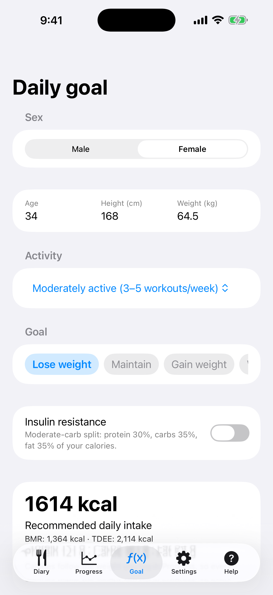
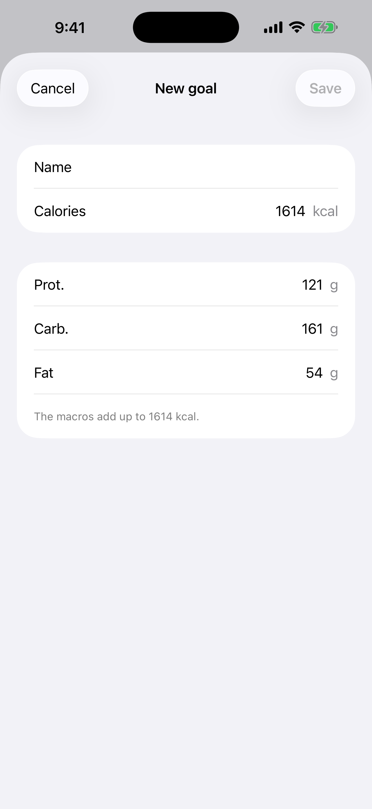
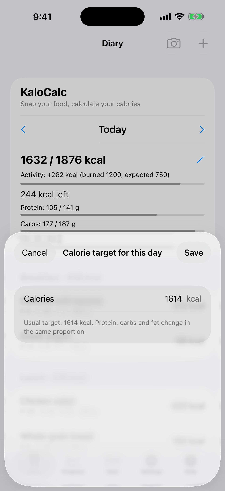

# 2. Objectif quotidien (calculateur)

Calculez l'apport quotidien recommandé en calories et en macros.

**Prérequis:** Aucun.

## Étapes

1. Ouvrez l'onglet **Objectif**. Choisissez **Sexe** et saisissez **Âge**, **Taille (cm)** et **Poids (kg)**.

   

2. Choisissez l'activité et l'objectif (**Perdre du poids**, **Maintenir** ou **Prendre du poids**). Faites défiler la ligne des objectifs sur le côté pour atteindre vos objectifs enregistrés, et créez le vôtre avec **Nouvel objectif**. En option, activez **Insulinorésistance** pour une répartition à glucides modérés.

   

3. Vérifiez le résultat sous **Apport quotidien recommandé** (BMR, TDEE, protéines, glucides, lipides) puis touchez **Enregistrer le profil**.

4. Pour changer l'objectif d'un seul jour, ouvrez le **Journal**, touchez le crayon à côté des calories du jour et saisissez le nombre. **Revenir à l'objectif habituel** rétablit l'objectif habituel.

   

## Résultat

L'objectif apparaît dans le Journal et pilote les graphiques de Progrès, et les calories suivent le poids que vous saisissez dans **Progrès**. La formule est celle de Mifflin-St Jeor. C'est une estimation, pas un avis médical.

---

[← Précédent](01-first-start.md) · [Retour au sommaire](../../README.fr.md#sommaire) · [Suivant →](03-diary-add-manually.md)
