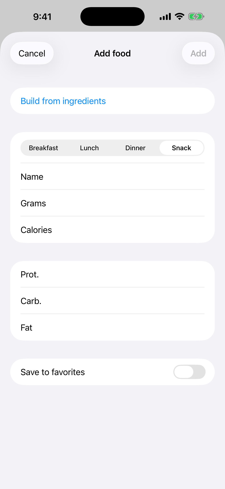
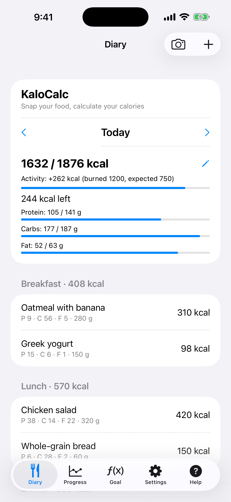

# 3. Ajouter un aliment manuellement

Enregistrez un repas dans le journal avec nom, grammes, calories et macros.

**Prérequis:** Aucun.

## Étapes

1. Dans le **Journal**, touchez **+** (en haut à droite). Sur l'écran **Rechercher un aliment**, touchez **Ajouter manuellement**.

   

2. Choisissez le repas, saisissez **Nom**, **Grammes**, **Calories** ainsi que protéines, glucides et lipides, puis touchez **Ajouter**.

   

3. L'entrée apparaît sous son repas et le total et le reste de la journée se mettent à jour.

   

## Composer un repas par ingrédients

Pour calculer un plat entier (par exemple un petit-déjeuner de flocons d'avoine, de graines et de fruits), touchez **Ajouter manuellement** puis **Composer par ingrédients**.

1. Saisissez un nom pour le repas et choisissez le repas.
2. Touchez **Ajouter un ingrédient**. Cherchez-le dans Open Food Facts ou saisissez vous-même le nom et les valeurs nutritionnelles.
3. Saisissez la **Quantité** : `50`, `1/2` ou `1 1/2`, et choisissez l'unité : g, ml, c. à s., c. à c., tasse ou pièce. Les grammes et les valeurs se remplissent tout seuls. Pour les pièces, réglez les **Grammes par pièce** (par exemple 180 pour une poire).
4. Répétez pour chaque ingrédient. Le total en grammes, calories et macros en haut se met à jour après chaque changement.
5. Pour baisser les calories, changez les grammes d'un ingrédient ou retirez-le avec la corbeille. Quand cela vous convient, touchez **Ajouter**. Touchez **Annuler** si vous vouliez seulement calculer.

Cochez **Ajouter aux favoris** pour garder tout le repas avec ses ingrédients.

## Résultat

Touchez une entrée pour la modifier. Balayez-la vers la gauche pour la supprimer.

---

[← Précédent](02-calculator-daily-norm.md) · [Retour au sommaire](../../README.fr.md#sommaire) · [Suivant →](04-search-and-barcode.md)
