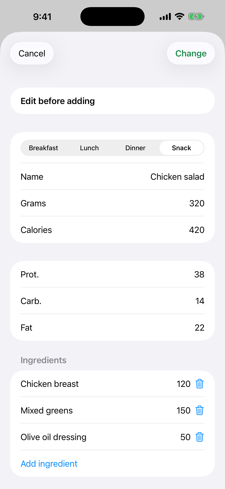

# 7. Corriger une estimation et « Tout ajouter »

Corrigez une estimation avant de l'enregistrer et ajoutez tous les aliments reconnus d'un coup.

**Prérequis:** Une estimation Gemini (scénario 6).

## Étapes

1. Sur une carte, touchez le bouton jaune **Modifier**. Modifiez le repas, le nom ou les grammes. Les calories et les macros sont recalculées à partir de l'estimation d'origine.

   

2. Vous pouvez ajouter ou retirer un ingrédient du plat.

3. Quand il y a deux aliments ou plus, touchez le bouton vert en haut (« Tout ajouter », avec le nombre et le total de calories) pour les enregistrer d'un coup dans le repas choisi.

## Résultat

Chaque entrée garde sa propre copie de la photo. Un plat ajouté quitte la liste et, après le dernier, l'écran se ferme.

---

[← Précédent](06-photo-gemini-estimate.md) · [Retour au sommaire](../../README.fr.md#sommaire) · [Suivant →](08-progress-charts.md)
