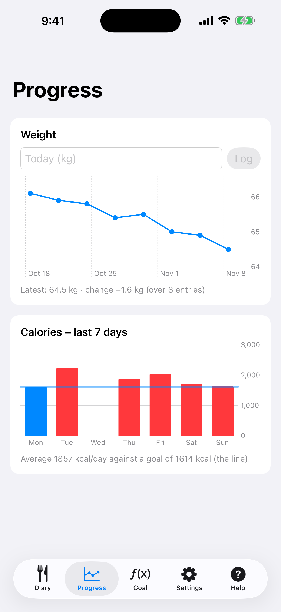

# 8. Progrès : poids et calories

Enregistrez votre poids et consultez les calories des 7 derniers jours.

**Prérequis:** Aucun.

## Étapes

1. Ouvrez l'onglet **Progrès**. Saisissez le poids du jour (**Aujourd'hui (kg)**) et touchez **Enregistrer**. Le graphique en ligne montre l'évolution.

   

2. Les barres en dessous sont les calories des 7 derniers jours et la ligne est votre objectif quotidien.

## Résultat

L'objectif de l'onglet Objectif suit le poids enregistré. Une pesée est conservée par jour ; en enregistrer une autre le même jour la remplace.

---

[← Précédent](07-edit-estimate-add-all.md) · [Retour au sommaire](../../README.fr.md#sommaire) · [Suivant →](09-apple-health.md)
