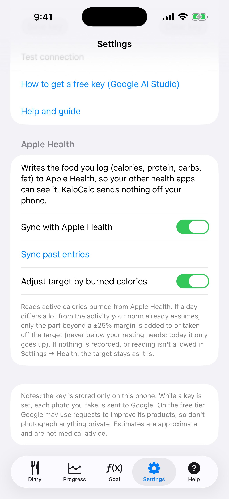

# 9. Apple Santé

Écrivez ce que vous saisissez dans Apple Santé et, si vous le souhaitez, laissez les calories brûlées ajuster l'objectif du jour.

**Prérequis:** Un iPhone (Santé est intégré). Les deux options sont désactivées tant que vous ne les activez pas.

## Étapes

1. Ouvrez **Réglages** et faites défiler jusqu'à **Apple Santé**.

   

2. Activez **Synchroniser avec Apple Santé**. iOS affiche une fenêtre d'autorisation ; autorisez KaloCalc à écrire les données de nutrition. Dès lors, chaque entrée que vous ajoutez ou modifiez est écrite dans Santé (calories, protéines, glucides, lipides) et une entrée supprimée est retirée. Si vous refusez, l'interrupteur se remet sur désactivé et un message indique où l'autoriser : Réglages → Santé → Accès aux données et appareils → KaloCalc.

3. Touchez **Synchroniser les entrées passées** pour écrire les entrées déjà saisies. Vous pouvez répéter sans risque : chaque entrée a un identifiant fixe et remplace sa copie précédente au lieu de la dupliquer.

4. Pour que l'activité déplace votre objectif, activez **Ajuster l'objectif selon les calories brûlées** et autorisez la lecture de l'énergie active. L'application lit seulement les calories actives du jour affiché, sur le téléphone.

5. Si une journée s'écarte beaucoup de l'activité que votre norme suppose déjà, le Journal affiche une ligne comme « Activité : +262 kcal (brûlées 1200, attendues 750) ». Seule la part au-delà d'une marge de ±25 % compte. Aujourd'hui l'objectif ne fait que monter ; une journée terminée peut aussi baisser, mais jamais sous vos besoins au repos. Un objectif fixé à la main pour un jour n'est pas modifié.

   

## Résultat

Rien ne quitte le téléphone. La nourriture écrite apparaît dans Santé sous Parcourir → Nutrition. iOS ne dit pas à une application si la lecture a été refusée : sans autorisation ou sans données, l'objectif reste simplement inchangé. Vous pouvez désactiver une option ici ou révoquer l'accès à tout moment dans Réglages → Santé → Accès aux données et appareils → KaloCalc ; les entrées déjà écrites restent dans Santé tant que vous ne les y supprimez pas.

> L'application iOS n'a pas encore de fichier de sauvegarde (export/import). Vos données sont sur l'iPhone et font partie de la sauvegarde iCloud ou sur ordinateur de l'iPhone.

---

[← Précédent](08-progress-charts.md) · [Retour au sommaire](../../README.fr.md#sommaire) · [Suivant →](10-language-and-settings.md)
