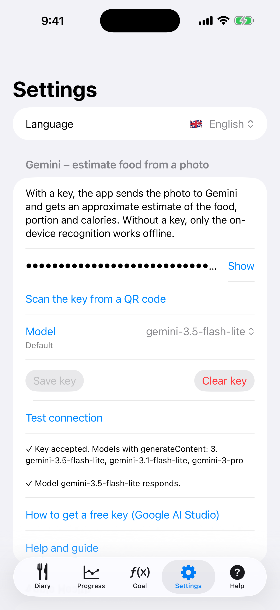
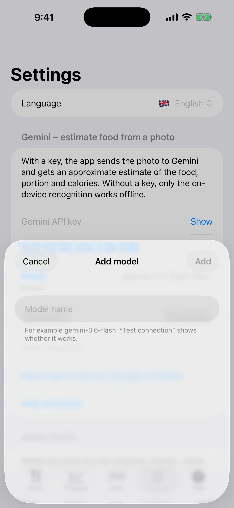

# 10. Réglages : langue et clé Gemini

Choisissez la langue, saisissez une clé Gemini et choisissez un modèle.

**Prérequis:** Pour la clé : un compte Google AI Studio.

## Étapes

1. Ouvrez **Réglages**. Collez la clé dans **Clé API Gemini** (**Afficher** l'affiche) ou utilisez **Scanner la clé depuis un QR code**, choisissez un **Modèle** et touchez **Enregistrer la clé**. La première fois que vous enregistrez une clé, une alerte demande si vous acceptez l'envoi des photos à Google. **Tester la connexion** vérifie la clé et le modèle. La façon d'obtenir une clé est décrite plus bas.

   

2. Le menu **Modèle** liste les modèles par défaut, et **Ajouter votre propre modèle…** permet de saisir le nom de votre propre modèle.

   

3. **Effacer la clé** supprime la clé et votre accord. **Aide et guide** ouvre ce guide dans le navigateur.

## Résultat

Sans clé, l'application ne fonctionne qu'avec les étiquettes hors ligne. La clé n'est conservée que sur le téléphone, dans le Trousseau iOS, et une sauvegarde ne la transfère pas vers un autre appareil.

## Comment obtenir une clé Gemini

Ouvrez [aistudio.google.com/api-keys](https://aistudio.google.com/api-keys) dans un navigateur. Tous les navigateurs conviennent (Chrome, Firefox, Edge, Safari), sur le téléphone ou sur un ordinateur. La clé est une longue chaîne qui commence par `AIza`. Elle est gratuite et ne demande pas de carte bancaire. Si vous avez déjà utilisé Google AI Studio, vous arrivez directement sur la liste des clés.

### Vous n'êtes pas connecté à Google (ou vous n'utilisez pas Chrome)

1. La page vous renvoie vers une connexion. Saisissez l'adresse e-mail et le mot de passe de votre compte Google personnel (Gmail). Si vous n'en avez pas, créez-en un avec « Créer un compte ».
2. Si le navigateur n'est pas Chrome, rien ne change : vous vous connectez sur la page de Google, pas dans le navigateur.
3. À la première visite, une fenêtre avec les conditions d'utilisation s'affiche. Cochez et acceptez, sinon la page ne continue pas.

### Vous avez plus d'un compte

1. Regardez l'icône ronde (photo ou lettre) en haut à droite. Elle indique avec quel compte vous êtes connecté.
2. Si ce n'est pas celui que vous voulez, touchez l'icône et choisissez un autre compte ou « Ajouter un autre compte ».
3. Si le navigateur vous connecte toujours avec le mauvais compte (par exemple professionnel), ouvrez la page dans une fenêtre de navigation privée et connectez-vous uniquement avec le compte voulu.
4. Les comptes professionnels et scolaires (Google Workspace) sont souvent bloqués par l'administrateur. Utilisez un compte personnel.
5. Les clés appartiennent à un compte. Une clé créée avec un compte n'est pas visible depuis un autre.

### Vous n'avez pas de clé : en créer une

1. Sur la page **API keys**, touchez **Create API key**.
2. Il demande un projet Google Cloud. Si vous en avez déjà un, choisissez-le dans la liste. Sinon, choisissez d'en créer un nouveau. Le nom n'a pas d'importance.
3. La clé apparaît dans la liste. Copiez-la (l'icône de copie à côté de la clé, ou ouvrez la clé et copiez-la là).
4. Si un message indique qu'il n'y a aucun projet, choisissez d'abord l'option pour créer ou importer un projet, puis recommencez l'étape 1.

### Vous avez déjà une clé : où la trouver

1. La même liste **API keys** affiche toutes les clés du compte, avec le nom, le projet et la date de création.
2. Touchez la ligne de la clé pour la voir en entier et la copier. Si seule une partie est affichée (`AIza...xxxx`), ouvrez ses détails.
3. Aucune clé dans la liste ? Vous êtes probablement connecté avec un autre compte. Changez-en (voir plus haut). Si la clé a vraiment disparu ou si vous ne savez plus où elle est, créez-en une nouvelle ; l'ancienne ne gêne pas.
4. Ne partagez pas la clé et ne la montrez pas sur des captures d'écran. Celui qui l'a utilise votre quota.

### Comment la saisir dans l'application

- Sur le téléphone : copiez la clé, ouvrez les **Réglages** de l'application, collez-la et touchez **Enregistrer la clé**.
- Sur un ordinateur : envoyez-vous la clé (par exemple dans un message à vous-même) et copiez-la sur le téléphone, ou affichez-la en QR code et scannez-la depuis l'application.
- Touchez enfin **Tester la connexion**. Un résultat vert signifie que la clé fonctionne.

---

[← Précédent](09-apple-health.md) · [Retour au sommaire](../../README.fr.md#sommaire)
